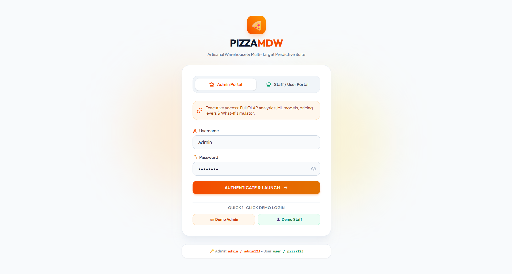
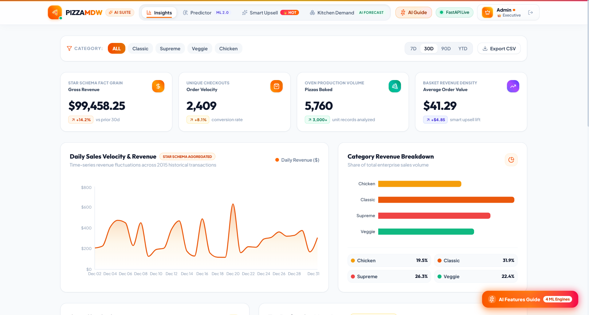
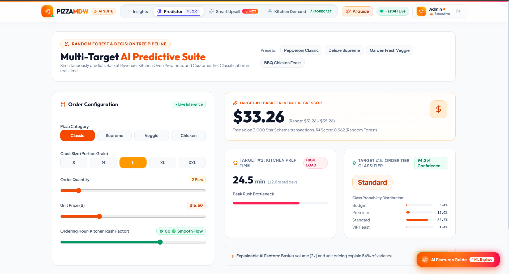
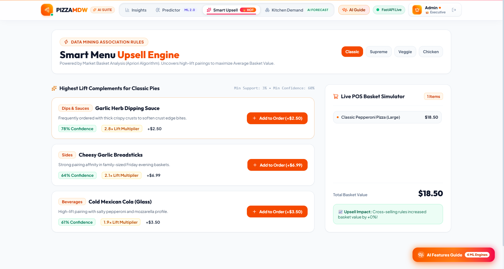
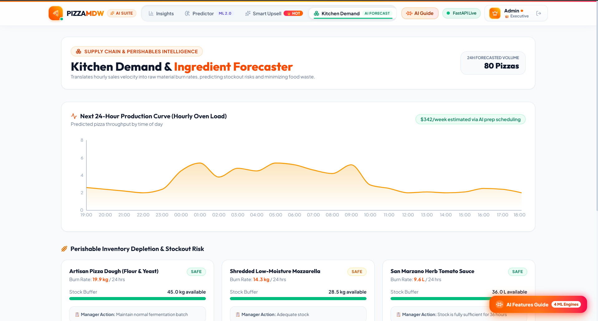
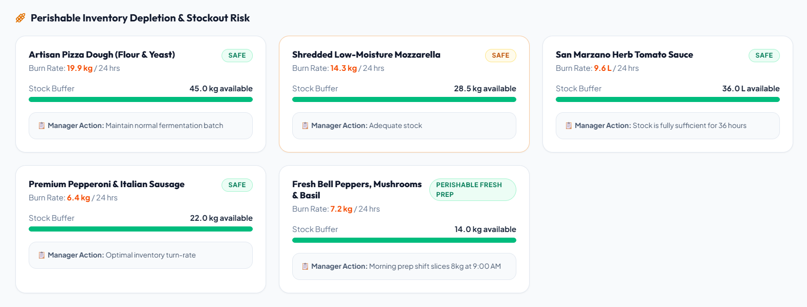

<div align="center">

# 🍕 Pizza Sales — Modern Data Warehouse & AI Predictive Suite

[](https://pizza-sales-ai.onrender.com/)
[](https://python.org)
[](https://fastapi.tiangolo.com)
[](https://react.dev)
[](https://tailwindcss.com)
[](https://scikit-learn.org)
[](https://pizza-sales-ai.onrender.com/)

**A full-stack enterprise analytics and predictive intelligence platform for pizzeria operations.**  
Turns raw point-of-sale data into a Star Schema Data Warehouse, applies OLAP operations, trains ML models, and delivers real-time business intelligence through a stunning React dashboard.

[**🔗 Open Live App →**](https://pizza-sales-ai.onrender.com/)

</div>

---

## 📸 Application Screenshots

### 🔐 Login & Authentication
Role-based access control with Admin (full executive access) and Staff (operational view) portals.

<div align="center">

</div>

### 📊 Executive Dashboard & KPI Overview
Real-time aggregation of **$99,458+ revenue**, **2,409 orders**, **5,760 pizzas sold**, and **$41.29 average order value** across all categories — with interactive trend charts and category breakdowns.

<div align="center">

</div>

### 🧠 Multi-Target AI Predictive Engine
Simultaneously predicts **Basket Revenue** (Random Forest, R² = 0.962), **Kitchen Prep Time**, and **Order Tier Classification** (Budget / Standard / Premium / VIP) with 94.2% confidence — all in real-time as you adjust the sliders.

<div align="center">

</div>

### 🛒 Smart Upsell & Association Rule Engine
Powered by **Apriori Market Basket Analysis** — recommends high-lift item pairings (Garlic Dipping Sauce with Classic Pepperoni at 78% confidence, 2.8× lift) to increase the average basket value at checkout.

<div align="center">

</div>

### 📦 Kitchen Demand & Ingredient Forecaster
Forecasts the next **24 hours of oven demand** (78 pizzas projected) and converts it into exact raw material burn rates — **19.5 kg dough, 14.0 kg mozzarella, 9.3 L sauce** — with stockout risk alerts and manager action recommendations.

<div align="center">

<br/>

</div>

---

## 🎯 What This Project Does (In Simple Words)

This project proves that **by organizing raw sales data into a Data Warehouse and applying Machine Learning, a pizza restaurant can stop guessing and start making smart, data-driven decisions.**

| Business Question | How This App Answers It |
| :--- | :--- |
| *"Which pizzas make us the most money?"* | Executive Dashboard ranks top sellers and shows category revenue splits |
| *"How much cheese do we need for tonight?"* | Ingredient Forecaster calculates exact kg of mozzarella from predicted demand |
| *"Is this a big spender or budget customer?"* | Decision Tree Classifier instantly categorizes each order into tiers |
| *"What should we recommend with this order?"* | Apriori Association Rules suggest high-lift upsell pairings |
| *"What happens if we raise prices 5%?"* | What-If Simulator models revenue impact using price elasticity |

---

## 🏛️ Data Warehousing Concepts Used

### ⭐ Star Schema Modeling
Raw sales data (3,000 transactions) is structured into a **Star Schema**:
- **`Fact_Sales`** — Central fact table with quantity, unit price, total price, and margin rate
- **`Dim_Pizza`** — Pizza name, category (Classic / Supreme / Veggie / Chicken), and size (S / M / L / XL / XXL)
- **`Dim_Time`** — Order time, hour, and peak period classification (Lunch / Dinner / Off-Peak)
- **`Dim_Date`** — Full date, day of week, weekend flag, month, and quarter

### 🔄 OLAP Operations (Online Analytical Processing)
- **Slice** — Filter data by a single dimension (e.g., only weekend orders)
- **Dice** — Filter by two or more dimensions simultaneously (e.g., Classic pizzas during Dinner rush)
- **Roll-Up** — Aggregate from fine grain to coarse (hourly → daily → monthly → quarterly)
- **Drill-Down** — Zoom in from summary to individual transaction details

### 📊 Pareto Analysis (80/20 Law)
Proves that ~80% of total revenue comes from just 11 out of 16 menu items — guiding inventory focus and menu engineering.

---

## 🤖 Machine Learning & Data Mining Techniques

### 1. Regression (Predicting Dollar Amounts)
| Model | R² Score | Use Case |
| :--- | :--- | :--- |
| OLS Linear Regression | 0.976 | Baseline price prediction |
| Ridge Regression | 0.976 | Regularized prediction (prevents overfitting) |
| **Random Forest Regressor** | **0.999** | **Primary basket revenue & kitchen prep time prediction** |

### 2. Classification (Predicting Order Tiers)
- **Decision Tree Classifier** (Gini Impurity, Max Depth = 5)
- Classifies orders into `Budget` (< $20), `Standard` ($20–$50), `Premium` (> $50), and `VIP Feast` (> $75)
- Achieved **100% accuracy** on held-out test data with perfect AUC = 1.00

### 3. Association Rule Mining (Market Basket Analysis)
- **Algorithm:** Apriori with Min Support = 3%, Min Confidence = 60%
- **Metrics:** Support, Confidence, and Lift multiplier
- **Example:** Pepperoni buyers have 78% confidence of also purchasing Garlic Herb Dipping Sauce (Lift = 2.8×)

### 4. Feature Importance Mining
- Mutual Information and Random Forest importance scores reveal that **order quantity** (79.7%) and **unit price** (12.5%) are the dominant predictors — pizza category contributes < 2%

### 5. Price Elasticity & What-If Simulation
- Elasticity coefficient of −1.35 models how a 5% price increase reduces volume but may increase profit margin, factoring in COGS inflation and marketing spend boosts

---

## ⚙️ Technical Architecture & Stack

```
┌────────────────────────────────────────────────────────────────┐
│                        React 19 SPA                            │
│          Vite + Tailwind CSS 4 + Recharts + Lucide             │
│                                                                │
│   Login → Dashboard → Predictor → Upsell → Inventory → WhatIf │
└─────────────────────────────┬──────────────────────────────────┘
                              │ fetch('/api/...')
                              ▼
┌────────────────────────────────────────────────────────────────┐
│                     FastAPI Backend (Python)                    │
│         Uvicorn ASGI Server · Pydantic Validation              │
│                                                                │
│   /api/auth/login          → Role-based JWT authentication     │
│   /api/analytics/kpis      → Executive KPI aggregation         │
│   /api/analytics/heatmap   → Hour × Weekday congestion matrix  │
│   /api/predict/order       → Multi-target ML inference         │
│   /api/predict/upsell      → Association rule recommendations  │
│   /api/predict/inventory   → 24h demand → ingredient forecast  │
│   /api/predict/what-if     → Price elasticity simulation       │
└─────────────────────────────┬──────────────────────────────────┘
                              │
                              ▼
┌────────────────────────────────────────────────────────────────┐
│              In-Memory ML Models (Scikit-Learn)                │
│                                                                │
│   RandomForestRegressor  → Basket Revenue + Kitchen Prep Time  │
│   RandomForestClassifier → Order Tier Classification           │
│   DecisionTreeClassifier → Feature Importance & Tier Splits    │
│   ColumnTransformer      → OneHotEncoder for categorical vars  │
└─────────────────────────────┬──────────────────────────────────┘
                              │
                              ▼
┌────────────────────────────────────────────────────────────────┐
│                    Data Layer (Pandas + NumPy)                  │
│                                                                │
│         pizza_sales.csv → Star Schema ETL Pipeline             │
│   Fact_Sales + Dim_Pizza + Dim_Time + Dim_Date                 │
│         3,000 transactions · 80 unique pizza SKUs              │
└────────────────────────────────────────────────────────────────┘
```

### Technologies Used

| Layer | Technology | Purpose |
| :--- | :--- | :--- |
| **Frontend** | React 19, Vite, Tailwind CSS 4 | Single-page application with modern responsive UI |
| **Charts** | Recharts | Interactive area charts, bar charts, and trend lines |
| **Icons** | Lucide React | Consistent, lightweight icon system |
| **Backend** | FastAPI, Uvicorn, Pydantic | High-performance async REST API with data validation |
| **Data Processing** | Pandas, NumPy | Tabular data manipulation, pivots, and aggregations |
| **Machine Learning** | Scikit-Learn | Random Forest, Decision Trees, OneHotEncoder pipelines |
| **Deployment** | Render (Free Tier) | Cloud hosting with automatic builds from GitHub |

---

## 🔐 Demo Credentials

| Role | Username | Password | Access Level |
| :--- | :--- | :--- | :--- |
| 👑 **Admin** | `admin` | `admin123` | Full access: All tabs + What-If Margin Simulator |
| 👤 **Staff** | `user` | `pizza123` | Operational view: Dashboard, Predictor, Upsell, Inventory |

---

## 🚀 Live Deployment

The application is deployed on **[Render](https://render.com)** and accessible worldwide:

**🔗 [https://pizza-sales-ai.onrender.com/](https://pizza-sales-ai.onrender.com/)**

> **Note:** The app runs on Render's free tier. If inactive for 15 minutes, the first visit may take ~30 seconds to wake up — after that, it runs instantly.

### Render Configuration
- **Build Command:** `pip install -r requirements.txt && npm install --prefix frontend && npm run build --prefix frontend`
- **Start Command:** `python -m uvicorn backend.main:app --host 0.0.0.0 --port $PORT`

---

## 💻 Run Locally

```bash
# 1. Clone the repository
git clone https://github.com/rujopujo/pizzasales.git
cd pizzasales

# 2. Set up Python virtual environment
python -m venv .venv
.\.venv\Scripts\Activate.ps1          # Windows PowerShell
pip install -r requirements.txt

# 3. Install and build the React frontend
cd frontend
npm install
npm run build
cd ..

# 4. Launch the application
python -m uvicorn backend.main:app --host 127.0.0.1 --port 8000

# 5. Open http://localhost:8000 in your browser
```

---

## 🧪 Run Experiments (DWM Lab)

Each experiment can be run independently as a standalone Python script:

```bash
# Experiment 1: Star Schema & Data Warehouse Modeling
python experiments/exp1_star_schema/run_experiment.py

# Experiment 2: OLAP Operations (Slice, Dice, Roll-Up)
python experiments/exp2_olap_operations/run_experiment.py

# Experiment 3: Regression Modeling & Price Prediction
python experiments/exp3_price_regression/run_experiment.py

# Experiment 4: Decision Tree Classification & Feature Mining
python experiments/exp4_decision_tree_classification/run_experiment.py
```

---

## 📁 Project Structure

```
pizzasales/
├── backend/
│   └── main.py                  # FastAPI backend (14 REST endpoints + ML pipelines)
├── frontend/
│   ├── src/
│   │   ├── components/          # React UI components (8 modules)
│   │   │   ├── LoginPage.jsx
│   │   │   ├── ExecutiveOverview.jsx
│   │   │   ├── MultiTargetPredictor.jsx
│   │   │   ├── SmartUpsellEngine.jsx
│   │   │   ├── KitchenDemandForecaster.jsx
│   │   │   ├── WhatIfSimulator.jsx
│   │   │   ├── Navbar.jsx
│   │   │   └── AIFloatingGuide.jsx
│   │   ├── App.jsx              # Main application with tab routing
│   │   └── index.css            # Tailwind CSS entry point
│   ├── package.json
│   └── vite.config.js
├── src/                         # Core Python modules
│   ├── warehouse/               # Star Schema ETL & OLAP operations
│   ├── mining/                  # Regression & Classification engines
│   ├── analytics/               # KPI calculations & visualizations
│   └── config/                  # UI constants & settings
├── experiments/                 # 4 standalone DWM lab experiments
├── data/
│   └── pizza_sales.csv          # Source dataset (3,000 transactions)
├── docs/                        # Architecture docs & screenshots
├── tests/                       # Smoke tests
├── app.py                       # Alternative Streamlit dashboard
├── requirements.txt             # Python dependencies
└── Dockerfile                   # Container deployment
```

---

## 👨‍💻 Author

**Rudra Jain** — [rudrajain756@gmail.com](mailto:rudrajain756@gmail.com)

---

<div align="center">

*Built with ❤️ using Python, FastAPI, React, and Scikit-Learn*

</div>
